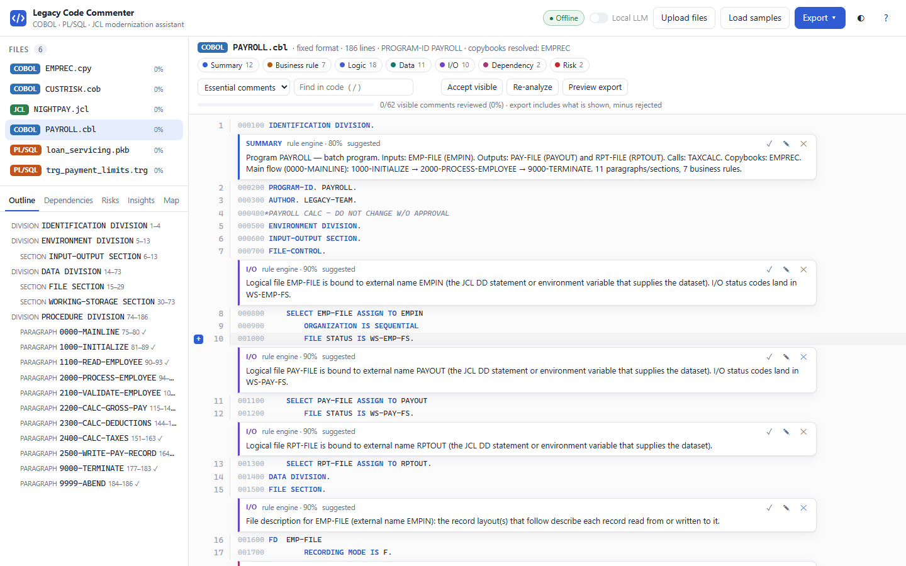

# Legacy Code Commenter

An offline web app that reads legacy **COBOL**, **PL/SQL** and **JCL** and writes plain-English inline comments explaining what the code does: business rules, calculations, data layouts, file and table dependencies, and migration risks. Developers review each suggestion, edit or reject it, and export annotated source plus a knowledge-transfer document.



## Why

Modernization teams lose weeks reverse-engineering code with sparse or outdated comments. This tool gives every paragraph, procedure and job step an explanatory header. It also surfaces the logic that's easy to miss: 88-level conditions, truncation instead of rounding, `COMMIT` inside loops, `WHEN OTHERS THEN NULL`, `GO TO`, `REDEFINES`, and JCL `COND` logic. And it maps how the files depend on one another.

## Quick start

Requires Python 3.10+ and nothing else: no `pip install`, no internet.

```bash
python run.py                 # opens http://localhost:8765
```

Click **Try the synthetic samples** to see it on the bundled demo codebase, or drop your own files onto the page. Press **?** for the built-in user guide.

```bash
python run.py annotate "src/*.cbl" -o out/ --doc   # batch mode for whole codebases
python run.py strip out/PAYROLL.annotated.cbl       # remove every [AI] comment again
python -m unittest discover -s tests -v             # 61 tests
python tools/evaluate.py                            # comprehension evaluation → docs/EVALUATION.md
python tools/anonymize.py client/ anon/ --key secure/key.json   # anonymise a client sample
python tools/validate.py anon/ --out validation/                # gates + SME review sheet
```

## Constraints and how they are met

| Constraint | How |
|---|---|
| Handle legacy syntax | Dedicated analyzers for COBOL (fixed and free format, copybooks, embedded SQL/CICS), PL/SQL (packages, triggers, cursors, exceptions) and JCL (COND, DISP, GDGs, in-stream DFSORT). A generic fallback covers other languages. |
| Offline / secure environments | Python standard library only, with no CDN or telemetry. Binds to `127.0.0.1`. A strict Content-Security-Policy blocks any outbound request from the page. |
| IP and confidentiality | The rule engine runs locally. The optional LLM must be on a loopback address (Ollama), and literals are masked before sending. The audit log records hashes, never code. |
| Non-intrusive comments | Only whole new comment lines are inserted, each tagged `[AI]`. Original lines are byte-identical; COBOL comments stay within column 72; JCL in-stream data is never split. `strip` restores the original exactly (verified by tests). |

## Deliverables

- **Web app**: upload, code navigation (outline, dependencies, risks, system map, search), comment review and editing, explain-a-selection, and export (annotated source, Markdown, JSON, ZIP).
- **User guide**: built into the app. Click **?** in the top bar, or open `http://localhost:8765/guide.html` on its own. It covers loading code, reading and reviewing comments, navigation, export, the optional LLM, keyboard shortcuts and a glossary of mainframe terms, for developers, analysts and project managers. **Print / PDF** produces a document copy. Source: [web/guide.html](web/guide.html).
- [Technical documentation](docs/TECHNICAL.md): architecture, analyzers, API, security, and how to extend it.
- [Evaluation](docs/EVALUATION.md): the comprehension demonstration on the synthetic codebase.
- [Validation guide](docs/VALIDATION_GUIDE.md): how to validate on an anonymised client sample, with SME scoring.
- `samples/`: a synthetic legacy codebase (payroll batch job, credit-risk program, loan-servicing package, trigger). It is regenerated by `tools/make_samples.py`. No client code is included.
